# Airlock: The Visual Merge Engine for Agentic Canvases

Git's standard line merge cannot resolve the visual intent of multiple agents writing HTML/CSS simultaneously. A reordered `div` can look like a delete and an insert in a string diff. Airlock parses DOM trees, uses positional LCS to match siblings, and lets designers resolve token conflicts visually before committing.

Airlock is a local, open-source MCP proxy and resolution layer for Paper Desktop. Agents draft against a shared canvas snapshot. The visual compiler combines independent structural edits, identifies conflicts, and replays the resolved draft to Paper. The diff works at the level of node and token intent. It uses no pixel comparisons.

Open **Merge State** from the draft manager for a before/proposed scrub of a single draft. The [Merge State guide](public/merge-state/README.md) covers its snapshot format and browser tests. The [write-up](write-up.md) explains compilation and replay.

The contrast demo runs on a persistent mock canvas. The bundled live adapter has also been verified with Paper Desktop: two drafts changed separate text layers in one frame, and the captured result matched the projection. Live support is limited to the documented adapter operations. The mock catalog is never a live fallback.

[See the live Paper merge projection](launch/airlock-live-merge-projection.png) · [See both calls applied in the live merge ledger](launch/airlock-live-merge-ledger.png)


## Run locally

Requires Node 20+ and pnpm. From this directory:

```sh
pnpm install --frozen-lockfile
pnpm build
pnpm start
```

Open **http://127.0.0.1:4317**. In a fresh mock workspace, choose **Load demo drafts**. Agent A adds a hero and turns the background black. Agent B adds a navbar with dark text. Pick a text-color swatch, then select **Compile & Merge Drafts**. Run `pnpm demo` against a separate fresh mock data directory to perform the same flow and print its MergeLedger. `pnpm dev` runs the UI directly from TypeScript. `pnpm test` runs the safety and integration tests; `pnpm check` checks types. The native SQLite dependency may need a compiler toolchain on platforms without a prebuilt binary.

The commands below use `node dist/cli.js`; the package also exports an `airlock` executable. `pnpm exec airlock` is available after installing the package as a dependency, or use a global package link.

```sh
node dist/cli.js open "Welcome screen" --agent Cursor
node dist/cli.js tools
node dist/cli.js draft <review-id> write_html @examples/mock-call.json
node dist/cli.js diff <review-id>
node dist/cli.js resolve <review-id> --diff-hash <inspected-diffHash>
node dist/cli.js commit <review-id> --token <approvalToken>
```

`mock-call.json` is a **mock-only fixture**, not a documented Paper input contract. `resolve` returns `{approvalToken, diffHash}`. The UI requires the hash of the displayed diff; the CLI's optional `--diff-hash` provides the same protection against unseen changes between inspection and approval. Keep the raw token private; you can pass it via `AIRLOCK_APPROVAL_TOKEN` instead of a shell argument. Resolving issues a diff-bound token. Committing replays the resolved draft. CLI exit codes: 0 success, 1 error, 2 partial merge.

## Record the merge demo

Start Airlock on port 3000 with a fresh mock data directory. The recorder loads the sample drafts if the workspace is empty. It commits the selected demo drafts as part of the recording.

```sh
pnpm exec playwright install chromium
pnpm exec tsx demo/record-video.ts
```

The recorder prints the absolute path to the 1280×800 WebM in `demo/recordings/`. Set `AIRLOCK_VIDEO_URL` if your Airlock UI uses a different port.

## Visual reviews on GitHub pull requests

Airlock compares the **merge toolbar** on the PR base and head at **390 px (mobile), 768 px (tablet), and 1440 px (desktop)**. The PR comment lists changed viewports, calls out newly clipped or removed merge buttons and label changes, and links to an archive with the before, after, and red diff images.

### Architecture

```mermaid
flowchart LR
    Agent["Agent or engineer"] -->|Opens or updates PR| Capture["GitHub Actions: capture"]
    Capture -->|Base and head assets, read-only| Docker["Docker: one container per revision"]
    Docker --> Browser["Playwright: headless Chromium"]
    Browser --> Diff["Pixel diff + toolbar checks"]
    Diff --> Images["GitHub Actions: screenshot artifact"]
    Diff --> Summary["GitHub Actions: JSON summary"]
    Summary --> Publisher["Trusted publisher workflow"]
    Publisher -->|Create or update| API["GitHub REST API"]
    API --> Comment["One comment on the PR"]
    Comment --> Images
```



- **Capture.** The unprivileged PR workflow builds the capture image from the base revision. A minimal Node server serves the compiler’s HTML, CSS, and JavaScript against fixed mock data. Each revision runs as a non-root user in a network-disabled container with a read-only source mount and a **120-second deadline**. A timeout forcibly removes the named container.
- **Compare.** Playwright captures the footer at three fixed sizes. The pixel differ paints changed pixels red and reports size changes. Separate DOM checks identify button removal, label changes, and new clipping. The base is the PR’s target commit; the head is the PR’s proposed commit.
- **Publish.** A separate workflow on the default branch reads the small, validated JSON summary and posts through the GitHub REST API. It checks that the PR is still open and the head still matches. The capture job has read-only repository permissions. The publisher has PR comment permission and does not run code from the PR. Screenshot artifacts are retained for 14 days.

### Try it on a PR

Merge the two visual workflows to the default branch. Open a PR that touches `public/compiler.css` and introduce a mobile-only regression, for example by constraining `#compile` to 90 px with hidden overflow below 480 px and preventing the label from wrapping. The comment should identify mobile and link to the artifact. Push a fix and check that the same comment updates.

The first version covers the single toolbar in its mock state. It does not run the Paper backend, arbitrary project build steps, or remote assets. Visual differences are reported for review and do not fail the workflow. Capture or artifact failures still fail the workflow and are visible under Actions.

### Run locally

Requires Docker with a Linux engine, Python 3.11+, and two Airlock checkouts.

```sh
docker build -t airlock-visual-ci visual-ci
python -m pip install -r visual-ci/requirements.txt
python visual-ci/compare.py --base ../base/public --head public --out visual-result
python -m unittest discover -s visual-ci -v
```

Open `visual-result/mobile-diff.png` for a sample output or `visual-result/summary.json` for the machine-readable report.

## Agent connection

Configure your MCP host to launch Airlock instead of giving that agent direct write access to Paper:

```json
{
  "mcpServers": {
    "airlock": {
      "command": "node",
      "args": ["/absolute/path/to/airlock/dist/cli.js", "serve"],
      "env": {
        "PAPER_MCP_MODE": "mock",
        "AIRLOCK_DATA_DIR": "/absolute/path/to/shared-airlock-data"
      }
    }
  }
}
```

Use the same **absolute** data directory and environment for the UI, CLI, and every agent process. Relative directories resolve from each process's working directory. On Windows, use a JSON-escaped absolute path or forward slashes.

Agent stdio exposes `merge_open_draft`, `merge_list_drafts`, `merge_list_contracts`, `merge_diff_intent`, `merge_write_draft`, and `merge_commit`. Discover upstream input/output contracts with `merge_list_contracts`, then pass the upstream arguments to `merge_write_draft`. Verified reads and passthrough tools keep their upstream names. Existing `airlock_*` agent calls remain callable as migration aliases.

The local UI and CLI resolve and discard drafts. A trusted operator can also launch `airlock serve --human-resolver` to use `merge_resolve` and `merge_discard` over stdio. Keep this transport, the shared database, and resolution tokens under human control. Agent stdio cannot generate a resolution token. `merge_commit` requires a token scoped to the inspected diff hash.

## Local Paper configuration

Copy `.env.example` to `.env`, configure a unique data directory and strong secret, and opt into live mode explicitly:

```dotenv
PAPER_MCP_MODE=live
AIRLOCK_LIVE_CONFIRM=1
AIRLOCK_APPROVAL_SECRET=<random-secret-at-least-32-characters>
AIRLOCK_DATA_DIR=.airlock-live
PAPER_MCP_ENDPOINT=http://127.0.0.1:29979/mcp
AIRLOCK_ADAPTER=./my-paper-adapter.mjs
```

Alternatively, point to your local bridge command:

```dotenv
PAPER_MCP_ENDPOINT='stdio:"C:/path with spaces/paper.exe" mcp'
```

Copy the actual bridge path from Paper's connection panel. `shell-quote` parses command/arguments without a shell; operators such as pipes, redirects, and command separators are rejected. Environment expansion is disabled. Shell scripts must be invoked through their explicit interpreter, and trusted command configuration is required.

Paper documents its local stdio bridge and legacy local HTTP endpoint in its [MCP guide](https://paper.design/docs/mcp). This is connection guidance only; no public-doc JSON schemas are copied or assumed. The client uses the [official TypeScript MCP SDK](https://github.com/modelcontextprotocol/typescript-sdk/tree/v1.x).

`client.connect()` races an 8-second timer by default. Timeout closes the client and reports:

```text
Could not connect to Paper MCP at <endpoint>. Is Paper Desktop running with a file open?
```

Set `PAPER_MCP_CONNECT_TIMEOUT_MS` if necessary. Use header-based credentials, not secrets embedded in endpoint URLs (the endpoint appears in errors).

### Edit separate text layers within a live Paper frame

Use the bundled adapter (`AIRLOCK_ADAPTER=./examples/live-adapter.mjs`). For a predictable target when multiple Paper files are open, set `PAPER_MCP_FILE_ID` and optionally `PAPER_MCP_PAGE_ID` to the IDs returned by your live endpoint. Restart the UI and agent transports with the same settings and data directory.

Open two drafts against the same captured frame. In each draft, record one plain-text `set_text_content` call for a different Paper Text layer. Discover the argument contract with `merge_list_contracts`. Select both drafts in the existing compiler, inspect the projection, then choose **Compile & Merge Drafts**. An overlap on the same text layer blocks the merge.

## Remote Paper configuration

Airlock can run near a cloud agent and connect to a configured, authenticated remote **Streamable HTTP** MCP endpoint:

```dotenv
PAPER_MCP_MODE=live
AIRLOCK_LIVE_CONFIRM=1
AIRLOCK_APPROVAL_SECRET=<random-secret-at-least-32-characters>
PAPER_MCP_ENDPOINT=https://your-paper-gateway.example/mcp
PAPER_MCP_HEADERS='{"Authorization":"Bearer <gateway-token>"}'
AIRLOCK_ADAPTER=./my-paper-adapter.mjs
```

That URL is illustrative, not a claim that Paper provides a public hosted service. Use a remote endpoint you operate or are authorized to access. Headers must be a JSON string-to-string object. Do not put them in version control. The local review UI binds only to `127.0.0.1`; reach a remotely running UI through a trusted tunnel. Airlock's agent-facing transport is stdio; remote capability here refers to its upstream Paper connection. Built-in OAuth negotiation and a public multi-user UI are outside this implementation.

## Live adapters and authoritative schemas

Start with `node dist/cli.js tools` in live mode to discover the configured endpoint’s contracts. The bundled `examples/live-adapter.mjs` supports plain-text updates to confirmed Paper Text layers and insertion into a captured empty page. The adapter captures supported JSX and verifies the base before replay. Live token capture and style editing are outside its current scope. Verify any adapter extension against a disposable Paper document.

The internal adapter interface is independent of Paper:

```ts
interface Adapter {
  classify(name: string): 'read' | 'write' | 'passthrough' | undefined;
  capture(paper: Paper): Promise<Snapshot>;
  normalize(
    name: string,
    args: Record<string, unknown>,
    state: Snapshot,
  ): Mutation[] | Promise<Mutation[]>;
}
```

`Snapshot` contains `canvas: Record<targetId, CanonicalNode[]>` and `tokens: Record<varName, string>`. Internal mutations replace a target's predicted HTML subtree or set/delete a global token. For an append-style upstream call the adapter must produce the entire resulting subtree, while the original upstream arguments remain the replay payload. Fail closed for tools or effects the adapter cannot represent. The core rejects embedded stylesheets; adapters need explicit normalization before supporting them.

The bundled capability map gives **names and rough purposes only**, never schemas. Actual availability and contract columns resolve at runtime:

| Name                                                | Classification | Rough purpose                       |
| --------------------------------------------------- | -------------- | ----------------------------------- |
| `get_basic_info`, `get_selection`                   | read           | Inspect file or selection           |
| `get_node_info`, `get_children`, `get_tree_summary` | read           | Inspect node structure              |
| `get_screenshot`, `get_jsx`, `get_computed_styles`  | read           | Inspect render/code/style           |
| `write_html`                                        | write          | Create or update HTML-derived nodes |
| `update_styles`, `set_text`, `delete_nodes`         | write          | Modify canvas content               |
| `create_artboard`, `duplicate_nodes`                | write          | Add canvas structures               |
| `finish_working_on_nodes`                           | passthrough    | Release working indicators          |

The classifier and this map agree. `finish_working_on_nodes` is always directly forwarded, never staged, diffed, or replayed. Mock-only `get_canvas` and `set_tokens` exist only in the fixture. Unknown names fail closed as writes; an adapter must verify any newly classified read.

## Contract cache and drift

Every cache record has `{tools, fetchedAt, hash, source, degraded, toolHashes, changed, removed, baseHash}`. Cache identity includes endpoint, mode, and a hash of headers; header values are not stored in cache keys. Mock cache provenance is `source: "catalog"`; live cache provenance is `source: "live"`.

`toolHash = sha256(name + canonical(inputSchema) + canonical(outputSchema ?? null))`. Descriptions, annotations, and other prose do not affect contract hashes. Object keys are sorted deterministically. The catalog's mock definitions are never used for live validation.

`airlock serve` and `airlock start` always attempt fresh `tools/list` on boot and fail if discovery fails. Other CLI commands also attempt refresh; if unreachable they can use an existing live cache only while inside `SCHEMA_CACHE_TTL_MINUTES` (default 60). Expired caches fail `schema_stale`. Long-lived processes refresh when TTL expires. Admit always requires live discovery again.

Changed hashes enter `changed`; missing tools enter `removed`. Both persist across refreshes. `airlock schema accept-drift` clears **only changed**, updating the accepted aggregate `baseHash`. Removed tools still throw `SCHEMA_REMOVED`. A restored tool requires contract inspection before recording drafts. Accepting drift does not reinterpret recorded calls: a group pinned to an old hash fails `staged_schema_drift` and must be drafted again with an updated adapter.

## Draft, resolution, and replay invariants

1. Capture a snapshot; store canonical `canvas_json`, `tokens_json`, and `base_hash = sha256(canvas_json + tokens_json)` in `snapshots`. Reviews opened on the same state share this hash, even with different snapshot IDs.
2. Validate against the discovered input contract. Normalize into separate `node_ops` and `token_ops`; replay information lives in ordered originating tool-call `groups`.
3. `write_html` is parsed with `node-html-parser`, never diffed as a string. Canonical nodes carry `path`, `tag`, `id`, `testid`, sorted `classes`, `text`, `style`, and extra attributes. Text preserves whitespace and descendant order so preformatted content and text moving around child elements cannot disappear from the diff. Matching order: unique ID → unique testid → tag/classes/text hash → positional LCS among siblings. Ambiguous duplicate IDs/testids are rejected.
4. CSS custom properties are global token operations keyed by `varName`; they do not require a target node. Node `var(--x)` references conflict with another pending review's `--x` mutation, in either direction. Conflict joins use shared snapshot `base_hash`. Subtree replacement overlaps are conservatively blocked even when different individual nodes changed, because replay replaces the whole subtree.
5. A human inspects and approves. `diffHash` hashes the sorted list of `{opId, after}` with canonical after-values. The random approval token is stored only as a keyed SHA-256 digest in `reviews.approval_token_hash`; the raw token is returned once, kept only in browser memory, and never persisted by Airlock. Every new staged op clears approval.
6. Admission checks token, current diff hash, pending conflicts, fresh schemas, pinned group contracts, and current base identity before the first run. Any external canvas change requires a new review; there is no automatic rebase.
7. Groups replay in order. A successful group marks all its ops `applied`. On the first thrown call or MCP `isError`, that group's ops become `failed` with `appliedWithinGroup: "unknown"`; every later group becomes `skipped`; the review becomes `partial`; replay stops. The MergeLedger has `partialWithinGroup: "unknown"`. **A failed group may have landed internally.** No inverse writes or automatic rollback are attempted. Every MergeLedger contains `atomic: false`.
8. Admitting a `partial` review without `--resume` fails `resume_required`. Resume skips applied groups and retries the first failed/skipped group as a whole. It uses the same diff-bound approval unless a human issues a replacement token. Completed groups are idempotent in Airlock; a partially failed upstream call may duplicate internal effects on retry. Inspect Paper first.

```sh
node dist/cli.js commit <review-id> --token <approvalToken> --resume
```

The durable SQLite lock serializes mutation/admission across cooperating processes using the same database. It is intentionally not automatically expired: a timed-out process may have sent a write. After a crash, **stop all Airlock processes and inspect Paper**, then run `airlock recover --confirm-stopped`. An interrupted applying group becomes failed/unknown; later groups become skipped. Restart the UI/agents and explicitly resume. Database transactions keep local bookkeeping consistent; they do not make Paper writes transactional.

## Limits and trust model

- The compiler combines writes to distinct captured subtrees and verified plain-text edits to separate layers within a Paper frame. Parallel full-subtree replacements sharing a target block replay. For generic token collisions the mock adapter can rewrite token writes to the chosen value. Live token selection requires verified adapter support.
- The contrast demo checks direct `--color-text` references against `--color-bg` with six-digit hex colors and a 4.5:1 threshold. It is a narrow check, and the projection is a structural preview with selected inline styles.

- **Token-to-token dependency resolution (`--a: var(--b)`) is out of scope.** Direct node-to-token references are detected; transitive token dependency graphs are not.
- Live semantic coverage depends on a verified adapter and a complete snapshot. No stable Paper JSON schema is assumed. The demo's replacement semantics are deliberately mock-only.
- HTML normalization is structural rather than a full browser CSS engine. Stylesheets, scoped custom-property semantics, CSS escapes in variable names, generated content, and style inheritance need additional adapter support. Mock HTML uses inline styles; inline custom properties are lifted to global token operations.
- Airlock does not lock Paper itself. A direct client can race between preflight capture and replay. Remove direct agent write connections and coordinate human edits during admission. Resume cannot establish the precise internal result of a failed call; it therefore does not claim a clean base or perform rollback.
- The human UI is local, with host/origin checks, a per-process CSRF token, restrictive CSP, and no execution of draft HTML. It is not a hardened boundary against malicious software running as the same user. Do not expose it publicly.
- Reviews contain canvas content and original arguments in SQLite. Protect the data directory. Secrets and raw approval tokens are not written to it. Read/passthrough MCP results are forwarded as supplied by the upstream service.
- `better-sqlite3` is a local durable store, not a distributed coordinator. Processes coordinating reviews must share one database on a suitable local filesystem.

## Layout

`src/schema.ts`: discovery/cache/drift; `src/html.ts`: structural normalization; `src/engine.ts`: reviews, approvals, conflicts, admission; `src/paper.ts`: transports, classifier, mock fixture; `src/mcp.ts`: agent-facing server; `src/web.ts` and `public/`: local human UI; `src/cli.ts`: CLI. `test/` covers the hard requirements and transport/UI integration. CI runs mock checks on Node 20/22 on Windows and Linux.

MIT licensed.
